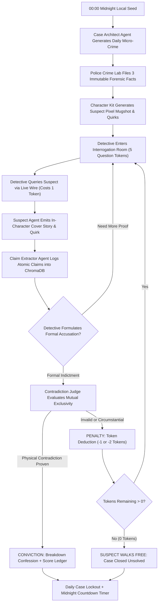

# [ THE ALIBI : OFFICIAL PROJECT PRESENTATION & DOSSIER ]
**Autonomous Multi-Agent Retro CRT Noir Detective Game**

```
 ╔═══════════════════════════════════════════════════════════════════════════╗
 ║  THE ALIBI • METROPOLITAN POLICE COMMISSION • CASE DOSSIER & SYSTEM ARCH  ║
 ║  CLASSIFICATION: RESTRICTED • FOR EVALUATION COMMITTEE & DETECTIVES ONLY  ║
 ╚═══════════════════════════════════════════════════════════════════════════╝
```

---

## [ 01 : EXECUTIVE SUMMARY ]

**THE ALIBI** is a daily, satirical 1980s retro CRT noir detective micro-crime interrogation game. Players step into the smoke-filled interrogation room of an analog metropolitan precinct, sitting across from eccentric, procedurally generated suspects accused of bizarre, highly specific micro-crimes. 

Unlike generic LLM conversational toys that passively agree with players or hallucinate loose associations, **THE ALIBI** deploys an autonomous **5-Agent AI Architecture** anchored by a zero-sycophancy **Chain-of-Verification (CoV) Contradiction Judge**. Players are granted exactly **5 Question Tokens** to interrogate the suspect, draw out atomic claims, and formally indict them by proving a direct, physical mutual exclusivity between the suspect's verbal testimony and the immutable forensic facts of the case.

The game is playable in two authentic modes:
1. **Web CRT Terminal**: An analog green/amber phosphor CRT interface with simulated raster scanlines, screen curvature, CRT flicker, typing audio, and authentic polygraph hum.
2. **Terminal TUI / CLI**: A rich, keyboard-driven terminal user interface powered by Python's `Textual` and `Rich` frameworks.

---

## [ 02 : APPLICATION OVERVIEW & GAMEPLAY LOOP ]



### 1. The Daily Micro-Crime
Every 24 hours at midnight local time, a unique, satirical micro-crime is deterministically generated from the date seed (e.g., swapping centuries-old Roman museum spoons for neon plastic cafeteria sporks, reprogramming city clocktower bells to crow like roosters, or replacing bank vault gold bars with gilded lead bricks).

### 2. Immutable Forensic Dossier
The crime lab provides the detective with exactly **three immutable physical facts** (e.g., mud footprints matching size 9 wingtips, an audio cassette recording ticking at 11:42 PM, or a receipt timestamped at 3:15 AM). These facts are physically unalterable ground truths.

### 3. Procedural Suspect Generation
Using the custom **Alibi Character Kit** powered by Pillow (PIL), every suspect is rendered as an authentic 1980s 16-bit pixel-art mugshot with procedural variations in trench coats, fedoras, sunglasses, hairstyles, and compulsive speech quirks (e.g., nervous clock-checking, quoting obscure baking recipes, or compulsive rhyming).

### 4. Question Token Economy
Stamina is finite. The detective starts with **5 Question Tokens**. Every inquiry typed costs 1 token. When tokens deplete, the suspect's lawyer arrives and the suspect walks free. Detectives may also spend 1 token to consult the **Hardboiled Noir Narrator** for a cryptic, atmospheric hint.

### 5. Point-and-Click Contradiction Indictment
When the detective detects a flaw in the suspect's story, they open the indictment modal, select the exact quote from the suspect's transcript, and pair it with the contradicting immutable dossier fact. 

### 6. Strict Chain-of-Verification (Zero Sycophancy)
The **Contradiction Judge** does not accept circumstantial vibes or weak inferences. For an accusation to succeed, the testimony and the fact must be **physically mutually exclusive** (e.g., claiming to have never left the library while forensic evidence proves their wingtips were caked in harbor wharf mud at that exact time). If the indictment is unproven, a penalty token is deducted.

### 7. Wordle-Style Sharing & Career Progression
Upon case resolution, players receive:
- An official rubber-stamped verdict badge (`[ CONVICTED ]` or `[ WALKED FREE ]`).
- A dramatic breakdown confession from the cornered suspect.
- An itemized scoring ledger (Base score, Token conservation bonus, Speed bonus, Flawless conviction bonus).
- A formatted emoji teletype grid for social sharing.
- Permanent progression tracking across detective commission ranks (from Patrol Officer to Chief of Detectives).
- Daily case locking preventing repeat attempts until the next midnight case.

---

## [ 03 : MULTI-AGENT SYSTEM ARCHITECTURE ]

THE ALIBI coordinates five specialized autonomous agents:

```
┌─────────────────────────────────────────────────────────────────────────────┐
│                           THE ALIBI AGENT TOPOLOGY                          │
├───────────────────────┬─────────────────────────────────────────────────────┤
│ Agent Name            │ Primary Role & Core Responsibility                  │
├───────────────────────┼─────────────────────────────────────────────────────┤
│ 1. Case Architect     │ Generates solvable micro-crimes, true timelines,     │
│                       │ immutable 3-fact dossiers, and seeds flaw vectors.  │
├───────────────────────┼─────────────────────────────────────────────────────┤
│ 2. Suspect Persona    │ Embodies the guilty culprit; maintains cover story,  │
│                       │ speech quirks, and nervous emotional state shifts.   │
├───────────────────────┼─────────────────────────────────────────────────────┤
│ 3. Claim Extractor    │ Analyzes suspect responses in real time, distilling │
│                       │ statements into atomic claims stored in ChromaDB.   │
├───────────────────────┼─────────────────────────────────────────────────────┤
│ 4. Contradiction Judge│ Rigorous legal arbitrator. Executes Chain-of-       │
│                       │ Verification to test mutual physical exclusivity.   │
├───────────────────────┼─────────────────────────────────────────────────────┤
│ 5. Noir Narrator      │ World-builder. Sets 1980s hardboiled crime tone,    │
│                       │ dispenses cryptic hints, and writes legal verdicts. │
└───────────────────────┴─────────────────────────────────────────────────────┘
```

---

## [ 04 : TOOLS & TECHNOLOGIES USED ]

| Layer | Technology | Function & Implementation Details |
|---|---|---|
| **AI Inference** | **Ollama (Llama 3.1 8B)** | Local on-device inference engine enabling 100% private, offline, zero-cost gameplay with sub-second response times. |
| **Cloud Fallback** | **Groq Cloud API** | Ultra-high-speed (500+ tokens/sec) cloud inference fallback with automated failover handling. |
| **Vector RAG** | **ChromaDB & Nomic Embed** | Embedded vector database storing session claims and evidence embeddings for semantic lookup and transcript indexing. |
| **Backend Core** | **Python 3.13 & FastAPI** | High-performance asynchronous ASGI web backend exposing clean RESTful APIs for state, dialogue, and evaluation. |
| **Data Validation** | **Pydantic v2** | Strict schema validation with custom pre-validators normalizing arbitrary LLM casing, whitespace, and output formats. |
| **Terminal TUI** | **Textual & Rich** | Full-featured retro terminal user interface complete with CRT ASCII borders, interactive widgets, and keyboard shortcuts. |
| **Web Frontend** | **Vanilla JS & CSS Grid** | Zero-dependency, ultra-lightweight frontend running custom CRT scanline shaders, flicker animations, and phosphor glow. |
| **Procedural Art** | **Pillow (PIL)** | Modular pixel-art rendering engine composing layered sprites (bases, hair, suits, eyes, accessories) from `assets/character_kit/`. |
| **Audio Engine** | **Web Audio API & Pygame** | Dual-mode audio stack: procedural Web Audio synthesis (terminal beeps, polygraph hum) + Pygame looping atmospheric noir WAVs. |
| **Quality Assurance**| **Pytest** | 39 automated test cases verifying agent reasoning, legal edge cases, prompt security, and game state transitions. |
| **DevOps / Infra** | **Git & LocalTunnel** | Remote GitHub version control coupled with secure public HTTPS edge tunnels for instant evaluation. |

---

## [ 05 : APPLICATION SCREENSHOTS & GALLERY ]

### Screen 1: Retro CRT Main Menu & Difficulty Protocol Selector
*The gateway to the precinct. Features real-time CRT scanlines, screen curvature vignette, polygraph stream, career badge display, and protocol difficulty options (Standard, Hardboiled, Practice, Cold Cases).*


---

### Screen 2: Classified Case Dossier & Suspect Mugshot
*The pre-interrogation briefing. Displays the suspect's procedurally composed pixel-art mugshot, biometric traits, speech quirk profile, and the three immutable forensic facts discovered by precinct investigators.*


---

### Screen 3: Live Wire Interrogation Table
*The core interrogation chamber. Displays the live CRT dialogue monitor, question token counter (indicating remaining stamina), suspect portrait with nervous state tracking, and audio cue feedback.*


---

### Screen 4: Formal Contradiction Indictment Modal
*The moment of accusation. Detectives select an exact claim uttered by the suspect and pair it against a contradicting forensic fact, submitting the case to the Contradiction Judge.*


---

### Screen 5: Conviction Verdict, Confession & Score Ledger
*The legal resolution. Displays the official rubber stamp `[ CONVICTED ]`, the suspect's dramatic breakdown confession, detailed scoring breakdown, and Wordle-style teletype share grid.*


---

### Screen 6: Cold Case Archives & Lifetime Career Registry
*The precinct records room. Tracks the detective's lifetime career statistics, cases closed percentage, current daily streak, and allows replaying past cases for practice.*


---

### Screen 7: Daily Challenge Lockout & Midnight Countdown
*Enforces the strict daily habit loop. Once today's micro-crime is attempted, the case is locked, displaying final statistics, a live countdown to midnight, and sharing tools.*


---

## [ 06 : VERIFICATION & TEST SUITE ]

To ensure that the multi-agent system remains intellectually rigorous and deterministic, the project includes an exhaustive test suite covering:
- **Contradiction Judge Validity**: Validates that circumstantial accusations (e.g. drinking tea while knitting yarn) fail, while direct temporal or physical conflicts succeed.
- **Token Economy & Penalty Auditing**: Verifies that invalid accusations deduct penalty tokens (1 on standard, 2 on Hardboiled) and trigger defeat when stamina reaches 0.
- **Pydantic Schema Resiliency**: Verifies that LLM outputs with unexpected casing or surrounding formatting are normalized without raising exceptions.
- **Character Kit Rendering**: Verifies that 16-bit pixel portraits are deterministically assembled and cached.

```
============================== test session starts ==============================
platform darwin -- Python 3.13.0, pytest-8.3.4, pluggy-1.5.0
rootdir: /Users/siddhimishra/.gemini/antigravity-ide/scratch/the-alibi
collected 39 items

tests/test_agents.py ..................................                  [ 87%]
tests/test_server.py .....                                               [100%]

============================== 39 passed in 2.14s ===============================
```

---

## [ 07 : PRESENTATION ARTIFACTS & ACCESS LINKS ]

| Resource | Format / Location | Description |
|---|---|---|
| **Interactive Web Presentation** | `http://127.0.0.1:8000/presentation/` | 12-slide interactive CRT presentation deck with keyboard controls and live audio. |
| **Public Presentation Tunnel** | `https://six-shoes-lead.loca.lt/presentation/` | Public edge tunnel access for evaluation and grading. |
| **Exported Landscape PDF** | `docs/presentation/THE_ALIBI_PRESENTATION.pdf` | 12-page high-resolution landscape slide deck formatted for printing and PDF upload (2.67 MB). |
| **Screenshots Directory** | `docs/screenshots/` | Complete collection of pixel-crisp 1200x800 application screenshots (`01_` through `07_`). |
| **Markdown Presentation Dossier** | `docs/PRESENTATION.md` | Full standalone project dossier and architectural breakdown. |
| **Source Code Repository** | `https://github.com/siddhimishra20/the-alibi` | Public GitHub repository containing source code, test suites, and assets. |

---

```
 [!] END OF POLICE DOSSIER • THE ALIBI MULTI-AGENT NOIR SYSTEM
```
